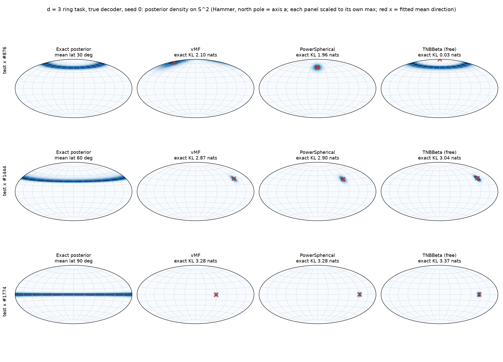
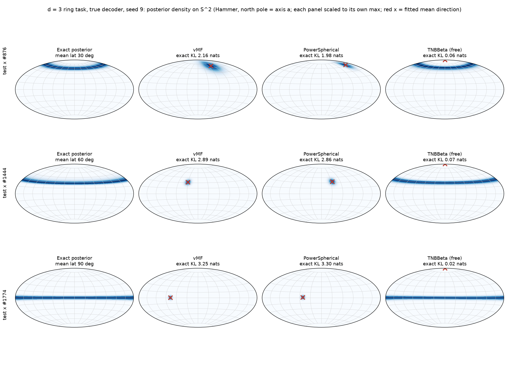

# Ring-posterior task, Levels 2 and 3 at d = 3 (single axis): results

Date: 2026-11-01. Pre-registration: `ring_posterior_design_2026-11-01.md` including its Deviations
(d = 3 only; Holm family of 4 = {vMF, PS} x {A, B}; X2 = 0.25 nats, X3 = 0.25 nats unchanged). L1 results:
`ring_posterior_recovery_2026-11-01.md` (24/27 cells pass).

Code version: base commit `ec2677e` (branch `synthetic-graph-families`) plus the UNCOMMITTED working tree
(`apps/synthetic/ring_recovery.py`, `src/tnbbeta_vae/data/ring_posterior.py`; GPU training and checkpoint saving were
added after L1). All TNBBeta runs here use the DEFAULT head init (raw 0, so p = q = 0.5); an
offset-initialised TNBBeta is being run separately and is not part of this note.

## Commands

    DIM=3 sbatch --array=0-16 scripts/slurm/ring_recovery.sbatch     # job 2288781 (+ retry 2288798_15), all COMPLETED
    uv run python -m apps.synthetic.ring_recovery summarize --out-dir ring_recovery/l23_d3
    uv run --with matplotlib python -m apps.synthetic.ring_sphere_plot --seed 0 9   # figures below

Raw outputs (untracked): `ring_recovery/l23_d3/stage2/d3_steps{2000,10000}.json`,
`ring_recovery/l23_d3/stage3/d3_{true,learned}_{vmf,power_spherical,tnbbeta,tnbbeta_fixed_m_neg,tnbbeta_fixed_m_ring}_s{0..9}.json`
(100 files) and `stage3/ckpt/*.pt`. The p-values and Holm step below were re-derived independently with scipy
(`wilcoxon(..., alternative="greater")`, exact distribution): they agree with `summarize` to all printed digits.

## Level 2 (per-datum optimisation, true decoder, 300 test x, sigma = 0.2): PASS

Exact KL(q || p_true), nats. "Amortised-like" = raw ~ 0.1 N(0,1) init (the pre-registered primary); "restarts" = best of 8
raw ~ N(0, 2^2) restarts chosen by ELBO. m = eps - 1 (d = 3).

| steps | family | init | KL mean | KL median | eps median | m median | frac m < 0 |
|---|---|---|---|---|---|---|---|
| 2000 | vMF | amortised-like | 4.78 | 3.88 | | | |
| 2000 | vMF | restarts | 3.91 | 3.36 | | | |
| 2000 | PS | amortised-like | 10.56 | 7.59 | | | |
| 2000 | PS | restarts | 6.54 | 6.48 | | | |
| 2000 | TNBBeta | amortised-like | 3.15 | **0.186** | 3.47 | 2.47 | 0.10 |
| 2000 | TNBBeta | restarts | -0.75 (see caveat) | 0.091 | 2.62 | 1.62 | 0.34 |
| 10000 | vMF | amortised-like | 3.00 | 2.54 | | | |
| 10000 | vMF | restarts | 2.67 | 2.55 | | | |
| 10000 | PS | amortised-like | 8.07 | 5.31 | | | |
| 10000 | PS | restarts | 3.61 | 3.18 | | | |
| 10000 | TNBBeta | amortised-like | 3.12 | **0.142** | 8.58 | 7.58 | 0.10 |
| 10000 | TNBBeta | restarts | -0.90 (see caveat) | 0.059 | 4.26 | 3.26 | 0.35 |

X2 rule (amortised-like, per budget): TNBBeta median 0.186 vs best cap median 3.88 (difference 3.70 >= 0.25) and 0.186 < 1.0:
PASS at 2000 steps; 0.142 vs 2.54 (difference 2.40): PASS at 10000 steps.

Fraction of x where TNBBeta has lower KL than both caps: amortised-like 0.837 (2000) / 0.787 (10000); restarts 0.987 / 0.933.
Per-x paired one-sided Wilcoxon (x is not an independent replicate of optimisation; descriptive): all p < 1e-10.
The mean (3.1) is far above the median (0.19) because 24% of x end with KL > 3: on those x TNBBeta stays in a cap-like
solution (a mixture of two outcomes, not a uniform small improvement). TNBBeta's pole mass is 0.016 (caps 0.05-0.08).

**Caveat (negative KL).** KL(q || p) >= 0 exactly, but the evaluated MC KL for TNBBeta is negative for 4/300 x
(amortised-like; minimum -4.6) and for 96-100/300 x of the random-restart runs (minimum -8.1; mean KL negative, hence the
-0.75 / -0.90 means above). The sampler/density consistency of `TNBBetaSpherical` at ordinary parameters is fine (I checked
that integral of q = 1 and P(w > 0.5) by sampling vs by density agree to ~0.003 for ten parameter settings in float32 and float64, and
`exact_kl` at 2000 vs 400000 samples agrees for five spiky/m < 0 settings), so I could not reproduce the cause. Something about the
optimised TNBBeta parameters makes the MC KL (and the 64-sample restart-selection ELBO, which shares log_prob/rsample) biased
downward, plausibly an estimator exploit at extreme parameters; it is UNRESOLVED. Consequence: the restart KL means are not
interpretable, the restart medians are somewhat contaminated, and the amortised-like median (pass criterion) is affected by at most
~1.3% of x. Stage 3 has no negative per-x KL in any true-decoder run, but see the learned-decoder seed 4 anomaly below.

## Level 3 (amortised MLP encoder, 10 seeds, 20000 train x, 100 epochs)

### Tests (one-sided paired Wilcoxon over seeds, H1: TNBBeta free better; Holm over 4 tests at 0.05)

| cond | vs | metric | mean paired diff (cap - TNB) | seeds TNB better | p | Holm threshold | reject |
|---|---|---|---|---|---|---|---|
| A (true decoder) | PS | exact test KL | 1.702 | 10/10 | 0.000977 (=2^-10) | 0.0125 | yes |
| A (true decoder) | vMF | exact test KL | 1.624 | 10/10 | 0.000977 (=2^-10) | 0.0167 | yes |
| B (learned decoder) | vMF | ELBO gap | 0.683 | 4/10 | 0.4229 | 0.025 | no |
| B (learned decoder) | PS | ELBO gap | 0.681 | 4/10 | 0.4229 | 0.05 | no |

Holm step: sorted p = (0.000977, 0.000977, 0.4229, 0.4229) against 0.05/4, 0.05/3, 0.05/2, 0.05/1 = 0.0125, 0.0167, 0.025, 0.05.
The two condition-A tests survive; both condition-B tests fail at the third step (0.4229 > 0.025). Margin X3 = 0.25: holds for the
mean differences in A (1.62, 1.70) and nominally in B (0.68), but the B mean is driven entirely by seed 4 (see below).

**Pre-registered L3 criterion ("TNBBeta uses its capacity" iff both tests survive Holm AND margin AND ring-shaped fits):
NOT MET** (only A survives). In condition A alone, the Holm tests, margin, and a majority ring-shaped fit all hold.

### Condition A (true decoder), exact test KL(q || p_true), mean +- sd over 10 seeds (descriptive for fixed-eps variants)

| variant | KL mean +- sd | band mass (>= 0.8 frac) | pole mass | eps med | m med | frac m<0 | abs cos(mu, a) |
|---|---|---|---|---|---|---|---|
| vMF | 2.702 +- 0.026 | 0.82 (0.65) | 0.039 | | | | 0.53 |
| PowerSpherical | 2.780 +- 0.050 | 0.83 (0.67) | 0.032 | | | | 0.53 |
| TNBBeta free | 1.078 +- 0.884 | 0.91 (0.94) | 0.009 | 8.08 | 7.08 | 0.00 | 0.83 |
| TNBBeta fixed m = -0.5 | 2.953 +- 0.888 | 0.87 (0.88) | 0.013 | 0.50 | -0.50 | 1.00 | 0.64 |
| TNBBeta fixed eps_ring (eps = 123.07) | 0.704 +- 0.308 | 0.94 (0.97) | 0.001 | 123.07 | 122.07 | 0.00 | 1.00 |

Per-seed free TNBBeta (true decoder): the 10 seeds split into two outcomes, not a continuum.
Seeds 2, 5, 6, 7, 9: KL 0.18-0.36, abs cos(mu, a) >= 0.999, band 0.94-0.96, eps 10-15 (aligned ring).
Seeds 0, 1, 3, 4, 8: KL 1.65-2.12, abs cos(mu, a) 0.63-0.72, band 0.87-0.89, eps 3.6-6.3 (mu not aligned with the axis;
KL only 0.6-1.1 nats better than the caps). Per-seed KL: 2.04 2.04 0.22 2.12 1.65 0.25 0.26 0.36 1.67 0.18; vMF 2.68-2.75 on
every seed. No free-TNBBeta fit had m < 0 (frac m < 0 = 0.00 in all 10 seeds): it does NOT take the bimodal/pole route, and
it is not simply a cap collapse: in the aligned seeds it is a ring, in the others a partial ring/cap hybrid (figure: seed 0
rings at latitude 30 but is a cap at 60 and 90 degrees). Free eps rises to ~10 from its softplus(0) = 0.69 start in the
aligned seeds, consistent with the eps_ring (123) control doing best. The fitted-marginal TV was not stored in the stage-3
JSON, so "ring-shaped" was assessed only by band mass (>= 0.8) and pole mass, not the registered TV < 0.25.

### Condition B (learned decoder), ELBO gap = log p(x) - ELBO on test (lower is better), descriptive

| variant | ELBO gap mean +- sd |
|---|---|
| vMF | 0.432 +- 0.009 |
| PowerSpherical | 0.430 +- 0.009 |
| TNBBeta free | -0.251 +- 2.268 |
| TNBBeta fixed m = -0.5 | 1.096 +- 0.008 |
| TNBBeta fixed eps_ring | 1.216 +- 0.230 |

Free TNBBeta per-seed gap: 0.66 0.26 0.57 0.27 **-6.69** 0.29 0.53 0.52 0.54 0.54, versus vMF 0.42-0.45 on every seed. Without seed 4 TNBBeta
free is WORSE than vMF/PS on 6 of the 9 other seeds (differences -0.24 ... +0.18, TNBBeta better on 3 of 9). Seed 4's gap is
physically impossible (a negative gap means the ELBO exceeds the true log p(x) by 6.7 nats per test x), so that run's TNBBeta
ELBO evaluation is almost certainly invalid, the same family of anomaly as the negative KL in L2 (unresolved). The B result is therefore
inconclusive at best; it is not evidence for TNBBeta. Learned sigma: vMF 0.192-0.195, TNBBeta 0.195-0.256 (true 0.2).
Fitted latitude marginal with the learned decoder is not meaningful (decoder can rotate the latent); the true-axis KL column of
the summary for B (~12-45 nats) should be ignored.

## Figures (condition A, d = 3, held-out test set seed 424242)

Exact posterior (computed with `RingPosteriorTask`) next to vMF, PowerSpherical and free TNBBeta, Hammer projection with the axis
`a` at the north pole, test x chosen by exact posterior mean latitude closest to 30, 60, 90 degrees (test indices 876, 1444, 1774),
each panel scaled to its own maximum, red x = fitted mean direction, per-x exact KL in titles.

* `figures/ring_d3_sphere_seed0.png` (seed 0, a partially aligned TNBBeta seed): TNBBeta recovers the latitude-30 ring
  (KL 0.03) but is a small cap at 60 and 90 degrees (KL 3.04, 3.37, no better than the caps, 2.87-3.28).
* `figures/ring_d3_sphere_seed9.png` (best free-TNBBeta seed, KL 0.18): TNBBeta is an aligned ring at all three latitudes
  (KL 0.02-0.07); caps are blobs (KL 2.2-3.3).

Script: `apps/synthetic/ring_sphere_plot.py` (matplotlib is not a project dependency; run with `uv run --with matplotlib`).

## What this does and does not show

* It shows that at d = 3 with a single axis, true decoder, an MLP encoder trained on the exact ELBO can find a TNBBeta posterior
  far closer to the latitude ring than any vMF/PS (A: 10/10 seeds, p = 2^-10, margin 1.6-1.7 nats), and that per-datum
  optimisation with the default raw-0 init reaches KL < 1 nat on 71% of x (median KL 0.19 vs 3.9).
* It does not show reliable discovery: with the default init only 5/10 seeds reach the aligned ring (KL ~0.2-0.4); the other 5
  stay within about 1 nat of the caps, and 24% of x are stuck in L2. The fixed-eps_ring control (eps from the data, label-free)
  reaches 0.70 +- 0.31 with every seed aligned, so part of the failure is eps having to climb from softplus(0), but the fixed variant is
  not uniformly better either (its worst seed is 1.19), and variants are descriptive only.
* It shows nothing for the learned-decoder condition B: the pre-registered tests fail, and the TNBBeta B numbers include an
  invalid-looking seed (ELBO above log p(x)).
* Free TNBBeta never used m < 0 (the bimodal regime), so this task shows ring capacity (m > 0 with interior latitude shape), not the
  antipodal-bimodality capability; fixed m = -0.5 is worse than the caps in A (2.95 vs 2.70).
* Limits: one axis, d = 3 (L1 shows d = 3 has the smallest gaps; d = 8, 16 untested), sigma = 0.2 only, 10 seeds, default TNBBeta
  head init (offset-init variant run separately), the true decoder in A is an oracle that is not available in practice, and the
  unresolved negative-KL / impossible-ELBO estimator anomaly for TNBBeta means TNBBeta MC KL/ELBO evaluations in this note are not fully
  trustworthy at extreme parameters. Stage 3 used 1000 q-samples per x for evaluation (design said 2000; recorded under Deviations).
